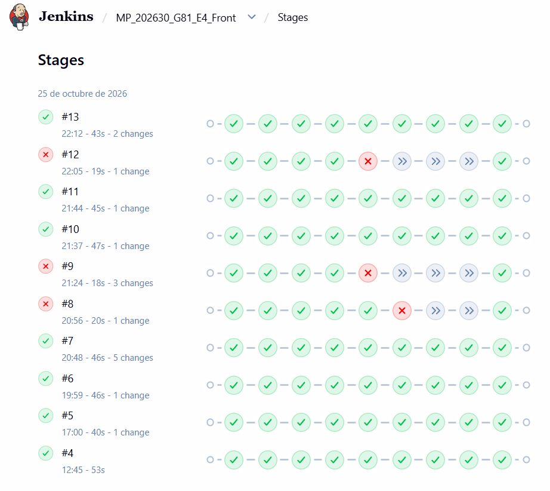
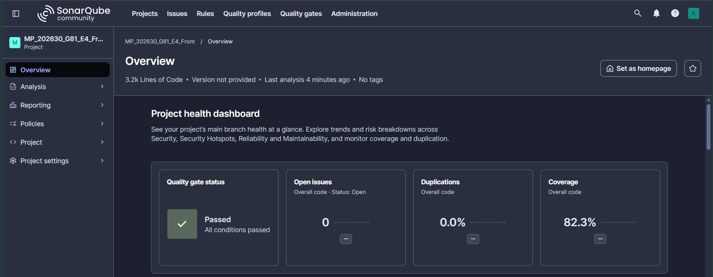

# Pets – Front-end

Aplicación web para gestionar adopciones de mascotas. Proyecto de Modelos de Programación, Universidad Distrital, grupo G81.

## Tecnologías

- React + Vite
- JavaScript (JSX)
- React Router
- CSS Modules
- Vitest y React Testing Library

## Requisitos

- Node.js compatible con la versión de Vite definida en `package.json`.
- Backend Spring Boot ejecutándose en `http://localhost:8080`.

## Instalación y ejecución

```bash
npm ci
npm run dev
```

Abre la URL que muestre Vite (normalmente `http://localhost:5173`). La configuración de Vite reenvía las peticiones `/api` a `http://localhost:8080`.

## Scripts

```bash
npm test
npm run test:coverage
npm run lint
npm run build
```

## Evidencia de pruebas automatizadas

Las pruebas automatizadas se ejecutan en un pipeline de Jenkins (instalación, lint, build, pruebas con cobertura y análisis estático) y los resultados de calidad se revisan en SonarQube.

Capturas del [DD/MM/AAAA], commit `[hash]`.

### Jenkins



### SonarQube



## HU01 – Consultar mascotas disponibles

Ruta: `/pets`.

La pantalla permite consultar y visualizar la lista de mascotas disponibles para adopción, buscar por nombre de la mascota y aplicar filtros por especie, raza o refugio. Además, la vista garantiza que solo se muestren mascotas con estado de adopción disponible y un estado de salud apto.

### Estado de integración

La interfaz y la lógica del servicio (petService.js) están preparadas para consumir el endpoint /pets del backend REST en Spring Boot. El comportamiento de la interfaz, el filtrado y la renderización se encuentran validados mediante pruebas automatizadas ejecutadas con Vitest y React Testing Library.

### Ejecución de pruebas

```bash
npm test
```

Para ejecutar únicamente la suite de esta historia de usuario:

```bash
npx vitest src/pages/PetsPage
```

### Ejecución de pruebas con cobertura

```bash
npm run test:coverage
```

### Pruebas manuales de integración

Una vez iniciados el frontend y el backend, se deberán verificar los siguientes escenarios:

* Iniciar el backend en Spring Boot y ejecutar npm run dev en el proyecto del frontend.
* Abrir la ruta /pets en el navegador y comprobar que se carguen las mascotas reales desde el servidor.
* Buscar una mascota por su nombre en la barra de búsqueda y validar la actualización dinámica de la lista.
* Aplicar filtros combinados de especie (ej. Perro/Gato), raza y refugio.
* Verificar que únicamente se muestren mascotas cuyo estado de adopción sea "Disponible".
* Confirmar que aquellas mascotas cuyo estado de salud sea "Enfermo" o "En tratamiento" no aparezcan en la grilla de adopción.
* Ingresar un filtro o búsqueda sin coincidencias y verificar que la interfaz despliegue el mensaje: "No se encontraron mascotas que cumplan con los filtros aplicados."
* Desconectar el servidor backend y comprobar el correcto manejo de errores de red en la pantalla (mensaje de fallo de conexión).

## HU02 – Registrar solicitud de adopción

Ruta: `/adoptions/new`.

La pantalla permite al adoptante registrar una solicitud de adopción indicando la mascota, la fecha y una descripción. Valida los datos y, cuando la solicitud no se puede registrar, muestra el motivo. Una solicitud registrada se puede consultar con su adoptante, mascota, fecha y estado.

Estado de integración: [completar].

## HU03 – Gestionar solicitud de adopción

Ruta: `/adoption-requests`.

La pantalla permite consultar y visualizar las solicitudes de adopción, buscar por adoptante, mascota o código de solicitud, filtrar por estado o mascota y acceder a las opciones de gestión disponibles en la interfaz, como aprobar, cancelar y editar solicitudes pendientes.

Estado de integración: La conexión con el backend está pendiente. Por lo tanto, las operaciones de consulta, aprobación, cancelación y edición aún no están verificadas mediante una integración completa con el servicio backend. El comportamiento de la interfaz se valida mediante pruebas automatizadas con Vitest y React Testing Library, utilizando servicios simulados (mocks).

### Ejecución de pruebas:
npm test
### Ejecución de pruebas con cobertura:
npm run test:coverage
### Pruebas manuales pendientes de integración

Una vez conectado el frontend con el backend, se deberán verificar los siguientes escenarios:

1.Iniciar el backend y ejecutar npm run dev.

2.Abrir /adoption-requests y comprobar que se carguen las solicitudes reales.

3.Buscar por nombre de adoptante, mascota o código y aplicar los filtros.

4.Aprobar una solicitud pendiente válida y verificar el cambio de estado en el backend.

5.Intentar aprobar una solicitud cuyo adoptante ya tenga una adopción activa y verificar el mensaje de error devuelto por el backend.

6.Cancelar una solicitud pendiente y comprobar que se actualice su estado.

7.Editar la fecha o descripción de una solicitud pendiente y verificar que los cambios persistan.

8.Desconectar el backend y comprobar el manejo del error de conexión y la opción de reintentar.

## HU12 – Gestionar información del adoptante

Ruta: `/profile`.

La pantalla permite al adoptante registrar, consultar y actualizar sus datos personales: dirección, teléfono y ocupación. La dirección y el teléfono son obligatorios, y si falta alguno se informa el motivo.

Estado de integración: [completar].

## HU13 – Gestionar refugios
Ruta: `/shelters`.

La pantalla permite registrar, consultar, actualizar y eliminar refugios. Se puede buscar por nombre, NIT o dirección. El formulario de registro y actualización valida que el NIT sea único y obligatorio, que el nombre sea obligatorio y que la capacidad sea un número mayor a cero. No se permite eliminar un refugio que tenga mascotas o procesos activos asociados. Las reglas de negocio se validan en el backend; los mensajes de error del API se presentan en la interfaz.

### Pruebas manuales sugeridas
1. Iniciar el backend y ejecutar `npm run dev`.
2. Abrir `/shelters` y comprobar que se cargue la lista de refugios.
3. Buscar por nombre, NIT o dirección y comprobar que la lista se filtre.
4. Registrar un refugio nuevo con NIT, nombre y capacidad válidos y comprobar que aparezca en la lista.
5. Intentar registrar un refugio con un NIT ya existente; comprobar que se muestre el error.
6. Intentar registrar un refugio sin NIT, sin nombre o con capacidad menor o igual a cero; comprobar que se informe el campo faltante o inválido.
7. Actualizar los datos de un refugio existente y comprobar que se guarden los cambios.
8. Eliminar un refugio sin mascotas asociadas y comprobar que desaparezca de la lista.
9. Intentar eliminar un refugio con mascotas o procesos activos asociados; comprobar que se muestre el error del backend.
10. Apagar el backend y comprobar que la pantalla muestre un error.

## Integración con Git
Desarrollar la HU13 en `feature/hu13-gestionar-refugios`. Crear un Pull Request hacia `develop` y solicitar la revisión de un compañero antes de fusionar.

## HU15 – Registrar reseña de una mascota

Ruta: `/pets/1/reviews`. El número corresponde al id de la mascota; con los datos de ejemplo actuales solo existe la mascota 1.

La pantalla muestra la ficha de la mascota, un formulario para dejar una reseña (calificación de 1 a 5 con estrellas y comentario obligatorio, con mensajes que explican el motivo cuando los datos no son válidos) y la lista de reseñas de esa mascota con su total. Al enviar una reseña válida, esta aparece al inicio de la lista. La reseña se firma con el usuario actual fijo definido en `src/config/currentUser.js`.

Estado de integración: La conexión con el backend está pendiente. La pantalla usa datos de ejemplo detrás de `src/services/reviewService.js`; al conectar el backend solo cambia el cuerpo de las funciones de ese servicio. El comportamiento de la interfaz se valida mediante pruebas automatizadas con Vitest y React Testing Library, utilizando servicios simulados (mocks).

## HU17 – Gestionar mensajes

Ruta: `/messages`.

La pantalla tiene dos bandejas, Recibidos y Enviados, con la lista de mensajes de cada una (remitente o destinatario, vista previa del contenido, fecha y estado Leído / No leído). Al abrir un mensaje recibido que aún no ha sido leído, se marca como leído. El panel de detalle muestra remitente, destinatario, fecha, estado y contenido. El remitente solo puede editar un mensaje mientras no ha sido leído, y un mensaje solo se puede eliminar después de haber sido leído; en ambos casos la interfaz deshabilita el botón y explica el motivo. El formulario "Nuevo mensaje" permite elegir un destinatario (sin incluir al usuario actual) y escribir el contenido, que es obligatorio; si el envío falla, se muestra el motivo informado por el servicio. La pantalla contempla los estados de carga, error y bandeja vacía. El usuario actual es fijo y se toma de `src/config/currentUser.js`.

Estado de integración: [completar].
