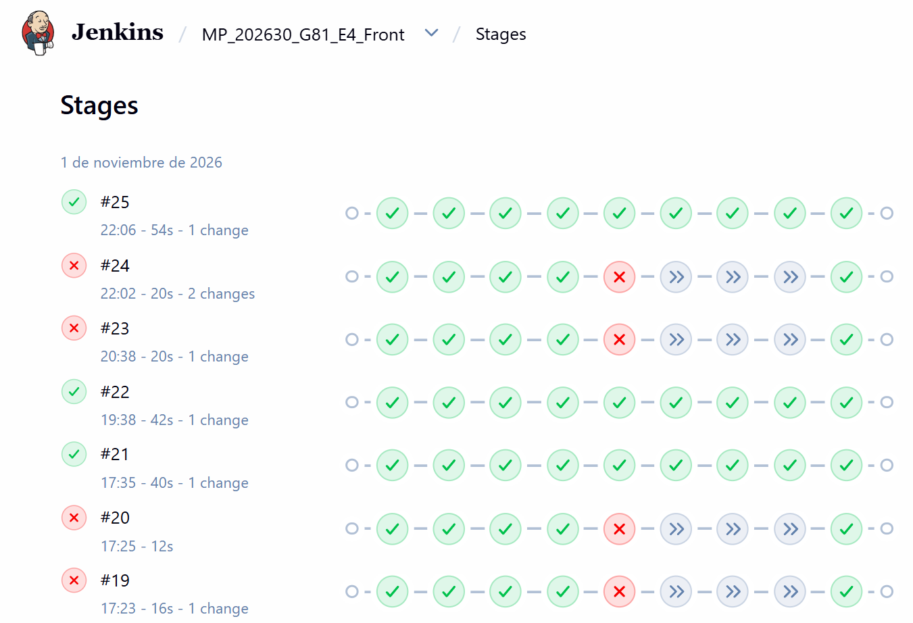
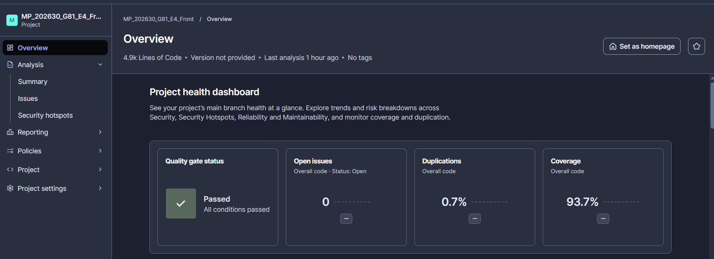

# Pets – Front-end

Aplicación web para gestionar adopciones de mascotas. Proyecto de Modelos de Programación, Universidad Distrital, grupo G81.

## Tecnologías

- React + Vite
- JavaScript (JSX)
- React Router
- CSS Modules
- Vitest y React Testing Library

## Requisitos

- Node.js compatible con la versión de Vite definida en `package.json`.
- Backend Spring Boot ejecutándose en `http://localhost:8080`.

## Instalación y ejecución

```bash
npm ci
npm run dev
```

Abre la URL que muestre Vite (normalmente `http://localhost:5173`). La configuración de Vite reenvía las peticiones `/api` a `http://localhost:8080`.

## Scripts

```bash
npm test
npm run test:coverage
npm run lint
npm run build
```

## Evidencia de pruebas automatizadas

Las pruebas automatizadas se ejecutan en un pipeline de Jenkins (instalación, lint, build, pruebas con cobertura y análisis estático) y los resultados de calidad se revisan en SonarQube.

Capturas del [DD/MM/AAAA], commit `[hash]`.

### Jenkins



### SonarQube



## HU01 – Consultar mascotas disponibles

Ruta: `/pets`.

La pantalla permite consultar y visualizar la lista de mascotas disponibles para adopción, buscar por nombre de la mascota y aplicar filtros por especie, raza o refugio. Además, la vista garantiza que solo se muestren mascotas con estado de adopción disponible y un estado de salud apto.

### Estado de integración

La interfaz y la lógica del servicio (petService.js) están preparadas para consumir el endpoint /pets del backend REST en Spring Boot. El comportamiento de la interfaz, el filtrado y la renderización se encuentran validados mediante pruebas automatizadas ejecutadas con Vitest y React Testing Library.

### Ejecución de pruebas

```bash
npm test
```

Para ejecutar únicamente la suite de esta historia de usuario:

```bash
npx vitest src/pages/PetsPage
```

### Ejecución de pruebas con cobertura

```bash
npm run test:coverage
```

### Pruebas manuales de integración

Una vez iniciados el frontend y el backend, se deberán verificar los siguientes escenarios:

* Iniciar el backend en Spring Boot y ejecutar npm run dev en el proyecto del frontend.
* Abrir la ruta /pets en el navegador y comprobar que se carguen las mascotas reales desde el servidor.
* Buscar una mascota por su nombre en la barra de búsqueda y validar la actualización dinámica de la lista.
* Aplicar filtros combinados de especie (ej. Perro/Gato), raza y refugio.
* Verificar que únicamente se muestren mascotas cuyo estado de adopción sea "Disponible".
* Confirmar que aquellas mascotas cuyo estado de salud sea "Enfermo" o "En tratamiento" no aparezcan en la grilla de adopción.
* Ingresar un filtro o búsqueda sin coincidencias y verificar que la interfaz despliegue el mensaje: "No se encontraron mascotas que cumplan con los filtros aplicados."
* Desconectar el servidor backend y comprobar el correcto manejo de errores de red en la pantalla (mensaje de fallo de conexión).

## HU02 – Registrar solicitud de adopción

Ruta: `/adoptions/new`. Opcionalmente, `/adoptions/new?petId=1` abre el formulario con esa mascota ya seleccionada.

La pantalla permite al adoptante registrar una solicitud de adopción indicando la mascota, la fecha y una descripción. El adoptante se toma del usuario actual fijo definido en `src/config/currentUser.js` y la solicitud se crea con estado `PENDIENTE`. Si la solicitud no se puede registrar (no se eligió una mascota válida, la mascota ya fue adoptada, falta la fecha o ya existe una solicitud pendiente para esa mascota), la pantalla muestra el motivo. Las solicitudes registradas se listan en "Mis solicitudes" con su mascota, fecha y estado. La pantalla contempla los estados de carga, error y lista vacía.

### Estado de integración

La conexión con el backend está pendiente. La pantalla usa datos de ejemplo en memoria detrás de `src/services/adoptionRequestService.js` (y de `src/services/adopterService.js` para el adoptante), por lo que los datos se reinician al recargar la página. Al conectar el backend solo debe cambiar el cuerpo de las funciones de esos servicios (recurso `/api/adoption-requests`); los nombres de las funciones se conservan.

Puntos a tener en cuenta al integrar:

* El backend recibe el adoptante y la mascota como objetos (`adopter` y `pet`, cada uno con su `id`).
* El backend no asigna el estado por sí mismo: la solicitud debe enviarse con estado `PENDIENTE`.
* Algunos mensajes de error del backend están en inglés; la pantalla debe mostrar su equivalente en español.

El comportamiento de la interfaz se valida mediante pruebas automatizadas con Vitest y React Testing Library, utilizando los servicios en memoria.

### Ejecución de pruebas

```bash
npm test
```

Para ejecutar únicamente las pruebas de esta historia de usuario:

```bash
npx vitest run src/pages/AdoptionRequestPage src/services/adoptionRequestService.test.js
```

### Ejecución de pruebas con cobertura

```bash
npm run test:coverage
```

### Pruebas manuales sugeridas

Con los datos de ejemplo (usuario actual: María Gómez, ID 12). Los datos de ejemplo se reinician al recargar la página.

1. Ejecutar `npm run dev` y abrir `/adoptions/new`. Comprobar que "Mis solicitudes" muestra tres solicitudes: Luna `PENDIENTE`, Max `APROBADO` y Nala `CANCELADO`.
2. Pulsar **Enviar solicitud** sin elegir mascota; comprobar que se informe que se debe seleccionar una mascota válida.
3. Elegir Max (ya adoptada) y enviar; comprobar que se informe que la mascota ya fue adoptada.
4. Elegir Luna (ya tiene una solicitud pendiente) y enviar; comprobar que se informe que ya existe una solicitud pendiente para esa mascota.
5. Elegir Toby, borrar la fecha y enviar; comprobar que se informe que la fecha es obligatoria.
6. Elegir Toby, dejar la fecha, escribir una descripción y enviar; comprobar el mensaje "Solicitud registrada para Toby." y que la solicitud aparezca primera en "Mis solicitudes" con estado `PENDIENTE`.
7. Recargar y abrir `/adoptions/new?petId=4`; comprobar que Toby llegue preseleccionado.
8. Pulsar **Cancelar** y comprobar que se navegue a `/adoptions`.

## HU03 – Gestionar solicitud de adopción

Ruta: `/adoption-requests`.

La pantalla permite consultar y visualizar las solicitudes de adopción, buscar por adoptante, mascota o código de solicitud, filtrar por estado o mascota y acceder a las opciones de gestión disponibles en la interfaz, como aprobar, cancelar y editar solicitudes pendientes.

Estado de integración: La conexión con el backend está pendiente. Por lo tanto, las operaciones de consulta, aprobación, cancelación y edición aún no están verificadas mediante una integración completa con el servicio backend. El comportamiento de la interfaz se valida mediante pruebas automatizadas con Vitest y React Testing Library, utilizando servicios simulados (mocks).

### Ejecución de pruebas:
npm test
### Ejecución de pruebas con cobertura:
npm run test:coverage
### Pruebas manuales pendientes de integración

Una vez conectado el frontend con el backend, se deberán verificar los siguientes escenarios:

1.Iniciar el backend y ejecutar npm run dev.

2.Abrir /adoption-requests y comprobar que se carguen las solicitudes reales.

3.Buscar por nombre de adoptante, mascota o código y aplicar los filtros.

4.Aprobar una solicitud pendiente válida y verificar el cambio de estado en el backend.

5.Intentar aprobar una solicitud cuyo adoptante ya tenga una adopción activa y verificar el mensaje de error devuelto por el backend.

6.Cancelar una solicitud pendiente y comprobar que se actualice su estado.

7.Editar la fecha o descripción de una solicitud pendiente y verificar que los cambios persistan.

8.Desconectar el backend y comprobar el manejo del error de conexión y la opción de reintentar.


## HU04 – Registrar adopción

Ruta: `/adoptions`.

La pantalla permite formalizar el registro de una adopción a partir de una solicitud de adopción previamente aprobada. Consulta las solicitudes mediante el servicio de solicitudes y muestra únicamente las que tienen estado `APROBADO`. Al seleccionar una solicitud, presenta la información del adoptante y de la mascota asociada; el usuario selecciona la fecha de adopción y envía el registro. La adopción se crea con estado inicial `ACTIVA` y se relaciona con el adoptante y la mascota de la solicitud aprobada.

La interfaz contempla los estados de carga, error y ausencia de solicitudes aprobadas, permite actualizar la lista y muestra mensajes de validación, error o confirmación durante el registro. Si no existen solicitudes aprobadas, informa que se necesita una solicitud aprobada para continuar.

### Estado de integración

La página está conectada en la aplicación mediante la ruta `/adoptions` y el enlace **Adopciones** del menú principal. El servicio `src/api/adoptions.js` está preparado para consumir el recurso `/adoptions`, y la página consulta las solicitudes a través del servicio de solicitudes. La integración de extremo a extremo con datos reales del backend aún debe verificarse; las pruebas de la página utilizan servicios simulados (mocks), por lo que sus resultados validan el comportamiento del frontend y no sustituyen la prueba contra el backend.

### Ejecución de pruebas

```bash
npm test
```

Para ejecutar únicamente las pruebas de esta historia de usuario:

```bash
npx vitest run src/features/adoptions/AdoptionsPage.test.jsx
```

### Ejecución de pruebas con cobertura

```bash
npx vitest run src/features/adoptions/AdoptionsPage.test.jsx --coverage
```

### Pruebas manuales sugeridas

1. Confirmar que exista al menos una solicitud de adopción con estado `APROBADO` en el backend.
2. Abrir `/adoptions` desde la opción **Adopciones** del menú y comprobar que se carguen únicamente las solicitudes aprobadas.
3. Seleccionar una solicitud y comprobar que se muestren el adoptante y la mascota asociados.
4. Seleccionar una fecha válida y registrar la adopción.
5. Comprobar que el frontend envíe la creación al recurso `/api/adoptions` y que el backend responda correctamente.
6. Verificar que se muestre la confirmación del registro y que la información se actualice después de la operación.
7. Probar el estado vacío cuando no existan solicitudes aprobadas y utilizar **Actualizar solicitudes** para volver a consultar.
8. Desconectar el backend y comprobar que se muestre el mensaje de error de conexión.


## HU07 – Registrar seguimientos veterinarios

Rutas: `/follow-ups/new` (registrar) y `/follow-ups/:id/edit` (actualizar).

La pantalla permite registrar y actualizar un seguimiento veterinario asociado a una adopción activa y a una mascota existente. El formulario incluye la adopción activa, la mascota, el veterinario responsable, la fecha de seguimiento (obligatoria), el estado y las notas u observaciones. Permite programar el seguimiento inicial requerido para confirmar una adopción como ACTIVA. Las reglas de negocio se validan en el backend; los mensajes de error del API se presentan en la interfaz.

### Pruebas manuales sugeridas

1. Iniciar el backend y ejecutar `npm run dev`.
2. Abrir `/follow-ups/new` y comprobar que se carguen los selects de adopciones activas, mascotas y veterinarios.
3. Intentar guardar sin seleccionar adopción, mascota, veterinario o fecha; comprobar que se informe el campo faltante.
4. Registrar un seguimiento con datos válidos (adopción activa, mascota, veterinario, fecha) y comprobar el mensaje de éxito.
5. Intentar registrar un seguimiento con una adopción inactiva o inexistente; comprobar que se muestre el error del backend.
6. Intentar registrar un seguimiento para una mascota o veterinario inexistente; comprobar que se informe que no fue encontrado.
7. Abrir `/follow-ups/FU-001/edit` (o un ID existente) y comprobar que el formulario se precargue con los datos del seguimiento.
8. Actualizar las notas o el estado de un seguimiento y comprobar que se guarden los cambios.
9. Seleccionar estado "Programado" para simular el seguimiento inicial de una adopción.
10. Apagar el backend y comprobar que la pantalla muestre un error.

## HU07 – Registrar seguimientos veterinarios
Rutas: `/follow-ups/new` (registrar) y `/follow-ups/:id/edit` (actualizar).

La pantalla permite registrar y actualizar un seguimiento veterinario asociado a una adopción activa y a una mascota existente. El formulario incluye la adopción activa, la mascota, el veterinario responsable, la fecha de seguimiento (obligatoria), el estado y las notas u observaciones. Permite programar el seguimiento inicial requerido para confirmar una adopción como ACTIVA. Las reglas de negocio se validan en el backend; los mensajes de error del API se presentan en la interfaz.

### Pruebas manuales sugeridas
1. Iniciar el backend y ejecutar `npm run dev`.
2. Abrir `/follow-ups/new` y comprobar que se carguen los selects de adopciones activas, mascotas y veterinarios.
3. Intentar guardar sin seleccionar adopción, mascota, veterinario o fecha; comprobar que se informe el campo faltante.
4. Registrar un seguimiento con datos válidos (adopción activa, mascota, veterinario, fecha) y comprobar el mensaje de éxito.
5. Intentar registrar un seguimiento con una adopción inactiva o inexistente; comprobar que se muestre el error del backend.
6. Intentar registrar un seguimiento para una mascota o veterinario inexistente; comprobar que se informe que no fue encontrado.
7. Abrir `/follow-ups/FU-001/edit` (o un ID existente) y comprobar que el formulario se precargue con los datos del seguimiento.
8. Actualizar las notas o el estado de un seguimiento y comprobar que se guarden los cambios.
9. Seleccionar estado "Programado" para simular el seguimiento inicial de una adopción.
10. Apagar el backend y comprobar que la pantalla muestre un error.

## HU09 – Consultar historial médico
**Ruta:** `/pets/:petId/medical-history`

La pantalla permite consultar en modo de solo lectura el historial médico de una mascota específica. Despliega información clínica como esterilización, enfermedades registradas, tratamiento actual y datos básicos de la mascota.

Estado de integración
La interfaz y la lógica del servicio (`medicalHistoryService.js`) están preparadas para consumir el endpoint `/pets/{id}/medical-history` del backend en Spring Boot. El comportamiento de la interfaz, el manejo de estados de error (HTTP 404) y la advertencia por ausencia de historial clínico se encuentran validados mediante pruebas automatizadas ejecutadas con Vitest y React Testing Library.

Ejecución de pruebas
Ejecución general:
npm test

Para ejecutar únicamente la suite de esta historia de usuario:
npx vitest src/pages/MedicalHistoryPage

Ejecución de pruebas con cobertura
npm run test:coverage

Pruebas manuales de integración

Una vez iniciados el frontend y el backend, se deberán verificar los siguientes escenarios:
1. Iniciar el backend en Spring Boot y ejecutar `npm run dev` en el proyecto del frontend.
2. Acceder a la ruta con el ID de una mascota existente (ej. `/pets/1/medical-history`) y validar la renderización correcta del historial médico y los datos del animal.
3. Ingresar un ID de mascota inexistente en la URL y comprobar que la interfaz despliega el mensaje de error: "La mascota indicada no fue encontrada."
4. Consultar una mascota válida pero sin historial médico y verificar el mensaje preventivo en pantalla indicando que la mascota aún no posee registros médicos.
5. Confirmar que no existan botones o formularios habilitados para modificar la información (modo de solo lectura).
6. Desconectar el servidor backend y comprobar el manejo de errores de red en la pantalla.

## HU12 – Gestionar información del adoptante

Ruta: `/profile`.

La pantalla permite al adoptante consultar y actualizar sus datos personales (dirección, teléfono y ocupación) y eliminar su registro cuando no tiene adopciones, solicitudes de adopción ni reseñas. La dirección y el teléfono son obligatorios; si falta alguno, los cambios no se guardan y se informa el motivo. Muestra además un resumen con la cantidad de solicitudes, adopciones y reseñas del adoptante. El adoptante se toma del usuario actual fijo definido en `src/config/currentUser.js`. La pantalla contempla los estados de carga y error.

Alcance pendiente: la pantalla no incluye todavía el registro inicial (alta) del adoptante; asume que el adoptante del usuario actual ya existe.

### Estado de integración

La conexión con el backend está pendiente. La pantalla usa datos de ejemplo en memoria detrás de `src/services/adopterService.js` (y de `src/services/adoptionRequestService.js` para contar las solicitudes), por lo que los datos se reinician al recargar la página. Al conectar el backend solo debe cambiar el cuerpo de las funciones de esos servicios (recurso `/api/adopters`); los nombres de las funciones se conservan.

Puntos a tener en cuenta al integrar:

* El backend devuelve del adoptante únicamente `id`, `address`, `phone` y `occupation`. El nombre y los contadores de adopciones y reseñas que muestra la pantalla deben obtenerse de otros recursos.
* El backend rechaza hoy cualquier actualización de un adoptante que tenga solicitudes de adopción, aunque la pantalla permite editar. Esta regla del backend está pendiente de ajustar.
* La eliminación de un adoptante con adopciones, solicitudes o reseñas también la rechaza el backend.

El comportamiento de la interfaz se valida mediante pruebas automatizadas con Vitest y React Testing Library, utilizando los servicios en memoria.

### Ejecución de pruebas

```bash
npm test
```

Para ejecutar únicamente las pruebas de esta historia de usuario:

```bash
npx vitest run src/pages/ProfilePage src/services/adopterService.test.js
```

### Ejecución de pruebas con cobertura

```bash
npm run test:coverage
```

### Pruebas manuales sugeridas

Con los datos de ejemplo (usuario actual: María Gómez, ID 12, con 3 solicitudes, 1 adopción y 2 reseñas). Los datos de ejemplo se reinician al recargar la página.

1. Ejecutar `npm run dev` y abrir `/profile`. Comprobar que se muestren la dirección, el teléfono y la ocupación, y el resumen de 3 solicitudes, 1 adopción y 2 reseñas.
2. Borrar la dirección y pulsar **Guardar cambios**; comprobar que se informe que la dirección es obligatoria.
3. Restaurar la dirección, borrar el teléfono y guardar; comprobar que se informe que el teléfono es obligatorio.
4. Cambiar la ocupación y guardar; comprobar el mensaje "Cambios guardados.". Ir a otra sección y volver a `/profile` sin recargar; comprobar que el cambio se mantiene.
5. Modificar un campo y pulsar **Descartar**; comprobar que el formulario vuelva a los valores guardados.
6. Comprobar que la tarjeta "Eliminar adoptante" muestra el aviso "No disponible: tienes adopciones, solicitudes de adopción o reseñas registradas." y que el botón **Eliminar mi registro** está deshabilitado.

La eliminación de un adoptante sin registros asociados (ID 13 en los datos de ejemplo) se valida en las pruebas automatizadas, porque el usuario actual fijo siempre tiene registros.

## HU13 – Gestionar refugios
Ruta: `/shelters`.

La pantalla permite registrar, consultar, actualizar y eliminar refugios. Se puede buscar por nombre, NIT o dirección. El formulario de registro y actualización valida que el NIT sea único y obligatorio, que el nombre sea obligatorio y que la capacidad sea un número mayor a cero. No se permite eliminar un refugio que tenga mascotas o procesos activos asociados. Las reglas de negocio se validan en el backend; los mensajes de error del API se presentan en la interfaz.

### Pruebas manuales sugeridas
1. Iniciar el backend y ejecutar `npm run dev`.
2. Abrir `/shelters` y comprobar que se cargue la lista de refugios.
3. Buscar por nombre, NIT o dirección y comprobar que la lista se filtre.
4. Registrar un refugio nuevo con NIT, nombre y capacidad válidos y comprobar que aparezca en la lista.
5. Intentar registrar un refugio con un NIT ya existente; comprobar que se muestre el error.
6. Intentar registrar un refugio sin NIT, sin nombre o con capacidad menor o igual a cero; comprobar que se informe el campo faltante o inválido.
7. Actualizar los datos de un refugio existente y comprobar que se guarden los cambios.
8. Eliminar un refugio sin mascotas asociadas y comprobar que desaparezca de la lista.
9. Intentar eliminar un refugio con mascotas o procesos activos asociados; comprobar que se muestre el error del backend.
10. Apagar el backend y comprobar que la pantalla muestre un error.

## Integración con Git
Desarrollar la HU13 en `feature/hu13-gestionar-refugios`. Crear un Pull Request hacia `develop` y solicitar la revisión de un compañero antes de fusionar.

## HU14 – Gestionar veterinarios

Ruta: `/shelters/1/veterinarians`. El número corresponde al id del refugio; con los datos de ejemplo actuales solo existe el refugio 1.

La pantalla muestra el refugio y dos paneles: la tabla de veterinarios registrados (nombre, licencia y teléfono, con acciones Editar y Eliminar) y un formulario para registrar un veterinario. Los tres campos son obligatorios y, si falta alguno, se informa cuál. Al pulsar Editar, el mismo formulario carga los datos del veterinario para actualizarlos. Al pulsar Eliminar se pide confirmación y, una vez eliminado, el veterinario deja de aparecer en la lista. Si el refugio no existe, la pantalla informa que no fue encontrado. Contempla los estados de carga, error y lista vacía.

Estado de integración: La conexión con el backend está pendiente. La pantalla usa datos de ejemplo detrás de `src/services/veterinarianService.js`; al conectar el backend solo cambia el cuerpo de las funciones de ese servicio. El comportamiento de la interfaz se valida mediante pruebas automatizadas con Vitest y React Testing Library, utilizando servicios simulados (mocks).

## HU15 – Registrar reseña de una mascota

Ruta: `/pets/1/reviews`. El número corresponde al id de la mascota; con los datos de ejemplo actuales solo existe la mascota 1.

La pantalla muestra la ficha de la mascota, un formulario para dejar una reseña (calificación de 1 a 5 con estrellas y comentario obligatorio, con mensajes que explican el motivo cuando los datos no son válidos) y la lista de reseñas de esa mascota con su total. Al enviar una reseña válida, esta aparece al inicio de la lista. La reseña se firma con el usuario actual fijo definido en `src/config/currentUser.js`.

Estado de integración: La conexión con el backend está pendiente. La pantalla usa datos de ejemplo detrás de `src/services/reviewService.js`; al conectar el backend solo cambia el cuerpo de las funciones de ese servicio. El comportamiento de la interfaz se valida mediante pruebas automatizadas con Vitest y React Testing Library, utilizando servicios simulados (mocks).

## HU17 – Gestionar mensajes

Ruta: `/messages`.

La pantalla tiene dos bandejas, Recibidos y Enviados, con la lista de mensajes de cada una (remitente o destinatario, vista previa del contenido, fecha y estado Leído / No leído). Al abrir un mensaje recibido que aún no ha sido leído, se marca como leído. El panel de detalle muestra remitente, destinatario, fecha, estado y contenido. El remitente solo puede editar un mensaje mientras no ha sido leído, y un mensaje solo se puede eliminar después de haber sido leído; en ambos casos la interfaz deshabilita el botón y explica el motivo. El formulario "Nuevo mensaje" permite elegir un destinatario (sin incluir al usuario actual) y escribir el contenido, que es obligatorio; si el envío falla, se muestra el motivo informado por el servicio. La pantalla contempla los estados de carga, error y bandeja vacía. El usuario actual es fijo y se toma de `src/config/currentUser.js`.

### Estado de integración

La conexión con el backend está pendiente. La pantalla usa datos de ejemplo en memoria detrás de `src/services/messageService.js` y `src/services/userService.js`, por lo que los datos se reinician al recargar la página. Al conectar el backend solo debe cambiar el cuerpo de las funciones de esos servicios (recursos `/api/messages` y `/api/users`); los nombres de las funciones se conservan.

Puntos a tener en cuenta al integrar:

* El backend maneja el remitente y el destinatario como objetos (`sender` y `receiver`, cada uno con su `id`), mientras que los servicios en memoria usan `senderId` y `receiverId`.
* Las reglas "solo el destinatario puede marcar un mensaje como leído" y "solo el remitente o el destinatario pueden eliminarlo" las aplica hoy el servicio en memoria; el backend no distingue quién realiza la operación.
* La organización que se muestra junto al nombre del destinatario (por ejemplo, Refugio Esperanza) es un dato de ejemplo que el backend no devuelve.

El comportamiento de la interfaz se valida mediante pruebas automatizadas con Vitest y React Testing Library, utilizando los servicios en memoria.

### Ejecución de pruebas

```bash
npm test
```

Para ejecutar únicamente las pruebas de esta historia de usuario:

```bash
npx vitest run src/pages/MessagesPage src/services/messageService.test.js src/services/userService.test.js
```

### Ejecución de pruebas con cobertura

```bash
npm run test:coverage
```

### Pruebas manuales sugeridas

Con los datos de ejemplo (usuario actual: María Gómez, ID 12). Los datos de ejemplo se reinician al recargar la página.

1. Ejecutar `npm run dev` y abrir `/messages`. Comprobar que la bandeja Recibidos muestra dos mensajes: el de Carlos Ruiz como "No leído" y el de Ana Torres como "Leído".
2. Pulsar el mensaje de Carlos Ruiz; comprobar que pasa a "Leído" y que se muestra su detalle.
3. Ir a Enviados y abrir el mensaje para Carlos Ruiz del 21 de octubre (No leído); comprobar que **Editar** está habilitado y **Eliminar** deshabilitado, con la nota "Solo se puede eliminar un mensaje después de que haya sido leído.".
4. Pulsar **Editar**, cambiar el texto y pulsar **Guardar cambios**; comprobar el mensaje "Mensaje actualizado.".
5. En Enviados, abrir el mensaje para Ana Torres (Leído); comprobar que **Editar** está deshabilitado con la nota "Un mensaje leído ya no se puede editar.", pulsar **Eliminar** y comprobar el mensaje "Mensaje eliminado." y que el mensaje desaparece de la lista.
6. En "Nuevo mensaje", pulsar **Enviar mensaje** sin llenar nada; comprobar que se informe que el contenido es obligatorio.
7. Escribir un contenido sin elegir destinatario y enviar; comprobar que se informe que el mensaje debe tener un destinatario. Comprobar además que la lista de destinatarios no incluye a María Gómez.
8. Elegir un destinatario, escribir un contenido y enviar; comprobar el mensaje "Mensaje enviado." y que el mensaje aparezca en Enviados, seleccionado y como "No leído".